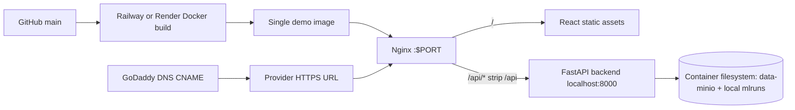

# Deploy Fast Demo to Railway (PATH A)

## Scout Findings / Decision Gate

| Gate | Finding | Impact |
|---|---|---|
| Single container? | No. Current local stack is `backend` FastAPI, `frontend` Nginx static site, and `nginx-proxy` in `docker-compose.yml`; repo has only `backend/Dockerfile` and `frontend/Dockerfile`. | PATH A requires a new single-container demo wrapper at the repo root. |
| Async workers? | No Celery/Kafka/worker service. Only FastAPI `BackgroundTasks` for preprocessing. | No separate worker infra needed for demo. |
| External dependencies? | No Mongo/Qdrant services. MLflow is a local file store (`backend/mlruns`); object store under `backend/data-minio`; reference data under `data/reference`. | Demo can run with bundled seed data, but uploads/training state is ephemeral unless a volume is used. |
| Configurable port? | Backend uses `${PORT:-8000}` in `backend/Dockerfile`, but `backend/healthcheck.py` is hardcoded to port 8000. | PATH A needs one public listener honoring the provider `$PORT`. |
| Build readiness? | `backend/Dockerfile` copies paths that are gitignored (`backend/data-minio/intake`, `backend/mlruns`, root `data/reference`). Remote Git builds may fail. | First task is artifact audit and Docker build repair. |
| Tests | Backend tests in `backend/tests`; frontend uses `npm run build` and `npm run lint`. | CI/CD can be added without inventing new frameworks. |

## Architecture — PATH A



## Tasks

1. **Task 1: Verify deployable artifacts and decide what seed data can ship**
    - Files to audit: `.gitignore`, `backend/Dockerfile`, `backend/data-minio/workspaces/`, `backend/mlruns/`, `data/reference/`
    - Confirm whether the files copied by `backend/Dockerfile` are tracked in Git and available to remote builders. List required seed artifacts: Fraunhofer workspace metadata, MLflow model registry state, PEM reference CSVs, training artifacts.
    - Commands:
      ```bash
      git ls-files backend/data-minio backend/mlruns data/reference | sed -n '1,120p'
      docker compose build --no-cache
      docker compose up -d
      curl -f http://localhost:3000/health
      docker compose down
      ```
    - Acceptance: A remote Git build will not depend on untracked local files, or the plan explicitly moves required seed artifacts into tracked deploy paths / external storage.

2. **Task 2: Add a single-container demo Dockerfile at repo root**
    - File: `Dockerfile.demo` (new)
    - File: `.dockerignore` (new, if absent)
    - Create a single image that:
      - installs Python backend deps with `uv` from `backend/pyproject.toml` and `backend/uv.lock`;
      - builds React with `VITE_API_URL=/api`;
      - copies frontend build output into Nginx;
      - copies backend app, `ml_lifecycle`, required seed data, and `healthcheck.py`;
      - starts `uvicorn app.main:app --host 127.0.0.1 --port 8000` and Nginx as the public process;
      - configures Nginx to listen on provider `${PORT:-8080}` and proxy `/api/*` to FastAPI while serving the SPA at `/`.
    - Suggested entrypoint:
      ```sh
      uvicorn app.main:app --host 127.0.0.1 --port 8000 & nginx -g 'daemon off;'
      ```
    - Acceptance: `docker build -f Dockerfile.demo -t mirai-demo .` succeeds from a clean checkout and `docker run -e PORT=8080 -p 8080:8080 mirai-demo` serves `/`, `/api/projects`, and `/health`.

3. **Task 3: Add provider config for Railway or Render**
    - File: `railway.toml` (new) or `render.yaml` (new)
    - Configure Dockerfile path `Dockerfile.demo`, healthcheck path `/health`, and restart policy.
    - Railway example:
      ```toml
      [build]
      dockerfilePath = "Dockerfile.demo"

      [deploy]
      healthcheckPath = "/health"
      restartPolicyType = "ON_FAILURE"
      ```
    - Acceptance: Provider detects the Docker build and exposes a public HTTPS URL without manual start-command edits.

4. **Task 4: Fix health checks for configurable ports**
    - File: `backend/healthcheck.py`
    - Read `PORT` and `HOST` from env. For demo image, use Nginx `/health` on public `$PORT` or keep backend healthcheck at backend port 8000 via `HEALTHCHECK_PORT`.
    - Acceptance: `curl -f http://localhost:8080/health` passes when demo image runs with `PORT=8080`.

5. **Task 5: Harden demo runtime environment variables**
    - Files: `env.example`, `README.md`
    - Document PATH A env vars:
      - `PORT` (supplied by Railway/Render);
      - `CORS_ORIGINS=https://<demo-domain>`;
      - `DOE_OBJECT_STORE_ROOT=/app/data-minio`;
      - `DOE_REFERENCE_DATA_ROOT=/app/data/reference`;
      - optional `MLFLOW_TRACKING_URI` (only if external MLflow is introduced later).
    - Acceptance: A new developer can deploy the demo without guessing required env vars.

6. **Task 6: Deploy PATH A to Railway/Render**
    - Connect GitHub repo, set branch `main`, set Dockerfile to `Dockerfile.demo`, set env vars, deploy.
    - Acceptance: Public demo URL loads React UI and API calls succeed through `/api`.

7. **Task 8: Add GitHub Actions CI for build validation**
    - File: `.github/workflows/ci.yml` (new)
    - Run backend tests with uv, frontend install/build, and demo Docker build.
    - Acceptance: Pull requests fail before deployment if tests/builds break.

---

## My To-Do List: Add the Web Domain for the Demo

> The following items require manual action to make the demo publicly accessible with a custom domain.

- [ ] **Purchase or confirm ownership** of `mirai-engineering.com` (or another desired domain) on GoDaddy or another registrar.
- [ ] **Get the Railway/Render provider hostname** after deploying (e.g., `mirai-app.ondigitalocean.app` or `mirai.onrender.com`).
- [ ] **Add a CNAME record** in GoDaddy DNS:
  - `demo` or `www` → `<provider-hostname>`
- [ ] **For the apex domain** (`mirai-engineering.com` without subdomain), use either:
  - Provider-supported apex record (`ALIAS`/`ANAME`/`CNAME FLATTEN`), or
  - Redirect apex to `www`/`demo` subdomain.
- [ ] **Verify TLS termination** — Railway/Render provisions SSL automatically; confirm the certificate is valid at `https://demo.mirai-engineering.com/`.

---

## Files to Modify

- `.gitignore` — only if seed/deploy artifacts need a tracked exception.
- `backend/Dockerfile` — keep as production backend-only image; remote builds may need fixing for untracked local state.
- `backend/healthcheck.py` — make healthcheck port configurable.
- `env.example` — document deployment env vars.
- `README.md` — add deployment section pointing to plan runbooks.
- `nginx/proxy.conf` — adapt listen port/upstreams for the demo image.

## New Files

- `Dockerfile.demo` — single-container Railway/Render demo image.
- `.dockerignore` — root Docker build exclusions.
- `railway.toml` or `render.yaml` — fast-demo provider config.
- `.github/workflows/ci.yml` — tests and Docker build validation.

## Dependencies

- Task 1 must happen before Tasks 2, 6.
- Task 2 must happen before Task 3 and 6.
- Task 3 must happen before Task 6.
- Task 4 can run in parallel with Task 2 but before deployment.
- Task 5 can run in parallel with Tasks 2-4.
- Task 6 depends on Tasks 2-5.
- Task 8 can run after first successful deployment but before repeated deploys.

## Risks

- **Remote build failure from gitignored data**: `backend/Dockerfile` copies `backend/mlruns`, `backend/data-minio/intake`, and `data/reference` which are gitignored. A clean remote build may fail.
- **Local filesystem persistence**: User uploads, BO logs, preprocessing reviews, and MLflow runs can disappear on redeploy without Railway/Render persistent volumes.
- **Long-running CPU/memory tasks**: ydata-profiling, training, BoTorch can exceed low-cost container limits. Start with at least 2GB RAM if available.
- **API prefix routing**: Frontend must use `VITE_API_URL=/api`; proxy must strip `/api` before forwarding.
- **CORS/domain mismatch**: Set `CORS_ORIGINS` to the final HTTPS demo domain.
- **Stale AWS script**: `deployments/deploy-aws.sh` is unsafe/stale (App Runner references). Do not use it.
