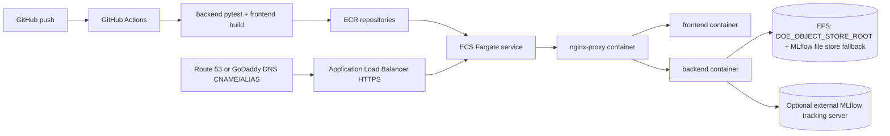

# Professional AWS Implementation (PATH B)

## Context

After the fast Railway/Render demo (PATH A) is in flight, build a proper production-grade AWS architecture that matches the repo's current FastAPI + React + MLflow/stateless architecture.

## Architecture — PATH B: AWS ECS/Fargate



## Tasks

1. **Task 9: Prepare AWS ECR repositories**
   - File: `docs/deployment/path-b-aws-ecs.md` (new runbook)
   - Document AWS CLI commands and account-specific variables.
   - Commands:
     ```bash
     export AWS_REGION=us-east-1
     export AWS_ACCOUNT_ID=$(aws sts get-caller-identity --query Account --output text)
     aws ecr create-repository --repository-name mirai/backend || true
     aws ecr create-repository --repository-name mirai/frontend || true
     aws ecr create-repository --repository-name mirai/nginx-proxy || true
     aws ecr get-login-password --region "$AWS_REGION" | docker login --username AWS --password-stdin "$AWS_ACCOUNT_ID.dkr.ecr.$AWS_REGION.amazonaws.com"
     ```
   - Acceptance: ECR repositories exist; `docker login` succeeds.

2. **Task 10: Add AWS deployment workflow**
   - Files: `.github/workflows/deploy-aws-ecs.yml` (new), `deployments/deploy-aws.sh` (modify or replace)
   - Replace the stale App Runner script. The workflow builds/pushes images to ECR and updates the ECS service.
   - Commands:
     ```bash
     docker build -f backend/Dockerfile -t $ECR_BACKEND:$GITHUB_SHA .
     docker build -f frontend/Dockerfile --build-arg VITE_API_URL=/api -t $ECR_FRONTEND:$GITHUB_SHA ./frontend
     docker build -f nginx/Dockerfile -t $ECR_PROXY:$GITHUB_SHA ./nginx
     aws ecs update-service --cluster mirai-prod --service mirai-web --force-new-deployment
     ```
   - Acceptance: A tagged image is pushed to each ECR repo and ECS service rolls to the new task definition.

3. **Task 11: Add production proxy image**
   - Files: `nginx/Dockerfile` (new), `nginx/proxy.conf` (modify)
   - Package the Nginx proxy as an ECR image. Proxy listens on port 80, forwards `/api/*` to backend container, and serves frontend static assets or routes to the frontend container.
   - Acceptance: Local `docker compose` or ECS-like test routes `/`, `/api/projects`, and `/health` through the proxy.

4. **Task 12: Define ECS task, ALB, and persistent storage**
   - Files: `infra/aws/ecs-task-definition.json` (new), `infra/aws/README.md` (new)
   - Define one ECS service with:
     - Fargate `2 vCPU / 4GB` initially (BoTorch, MLflow, ydata-profiling are memory-heavy).
     - Containers: nginx-proxy (public frontend), backend (internal), frontend (internal or static assets folded into proxy).
     - ALB target group routing `/health` to the proxy or backend.
     - EFS mount for `/app/data-minio` and `/app/mlruns` if not using external MLflow.
     - Secrets/env vars: `CORS_ORIGINS`, `DOE_OBJECT_STORE_ROOT`, `DOE_REFERENCE_DATA_ROOT`, `MLFLOW_TRACKING_URI`.
   - Acceptance: ECS task reaches steady state; uploads/training state survives task replacement.

5. **Task 13: Configure AWS domain and TLS**
   - File: `docs/deployment/path-b-aws-ecs.md` (updated)
   - Document ACM certificate creation (us-east-1 for global ALB), ALB HTTPS listener, and DNS records.
   - Commands:
     ```bash
     aws acm request-certificate --domain-name mirai-engineering.com \
       --subject-alternative-names www.mirai-engineering.com \
       --validation-method DNS --region us-east-1
     ```
   - Acceptance: `https://mirai-engineering.com/health` returns 200 through ALB after DNS propagation.

6. **Task 14: Validate deployment end-to-end**
   - File: `docs/deployment/deployment-runbook.md` (new)
   - Add smoke tests:
     ```bash
     export BASE_URL=https://<deployed-domain>
     curl -f "$BASE_URL/health"
     curl -f "$BASE_URL/api/projects"
     curl -f "$BASE_URL/api/workspaces"
     ```
   - Manual UI checks: project list loads, Fraunhofer demo loads, Model Quality shows active artifacts, Design Studio prediction works, BO page suggests expected state.
   - Acceptance: All smoke tests pass; no browser console API base-url errors.

---

## Files to Modify

- `backend/Dockerfile` — ensure production image works without untracked local state.
- `backend/healthcheck.py` — make port configurable for ECS task definition.
- `nginx/proxy.conf` — adapt upstream targets and listen port for ECS networking.
- `deployments/deploy-aws.sh` — replace with documented workflow or safe wrapper.

## New Files

- `docs/deployment/path-b-aws-ecs.md` — AWS ECS deployment runbook with commands.
- `.github/workflows/deploy-aws-ecs.yml` — ECR build/push + ECS deploy pipeline.
- `nginx/Dockerfile` — package proxy as ECR image for ECS.
- `infra/aws/ecs-task-definition.json` — ECS task definition (or use Terraform/CDK instead).
- `infra/aws/README.md` — AWS setup notes and required variables.
- `docs/deployment/deployment-runbook.md` — smoke tests and rollback notes for both paths.

## Dependencies

- Task 9 must happen before Task 10.
- Task 10 must happen before Task 12 (image naming decisions).
- Task 11 can run in parallel with Tasks 9-10.
- Task 12 depends on Task 10 completing.
- Task 13 depends on a successful infrastructure setup (Task 12).
- Task 14 depends on both PATH A and/or PATH B being deployed.

## Risks

- EFS cost scaling — monitor usage and set lifecycle policies.
- Fargate cold starts — acceptable for demo traffic but may need provisioned concurrency for production.
- Multi-container networking within Fargate — use Cloud Map or `localhost` for inter-container communication.
- Existing `deploy-aws.sh` is stale (App Runner) — do not execute before replacing.
