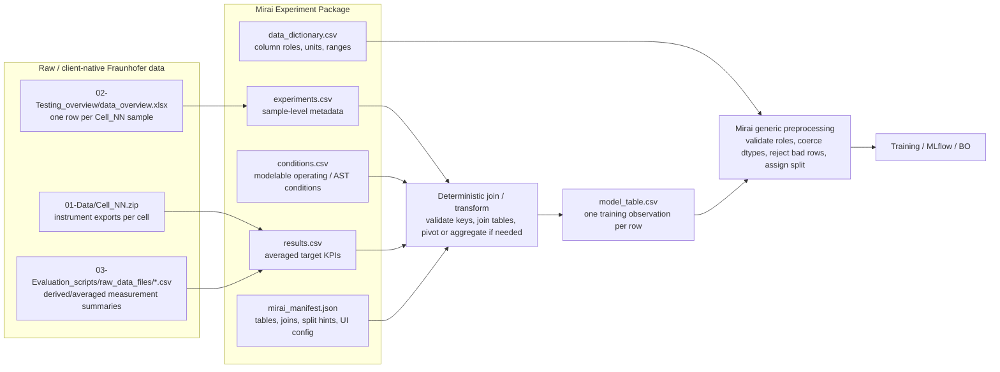
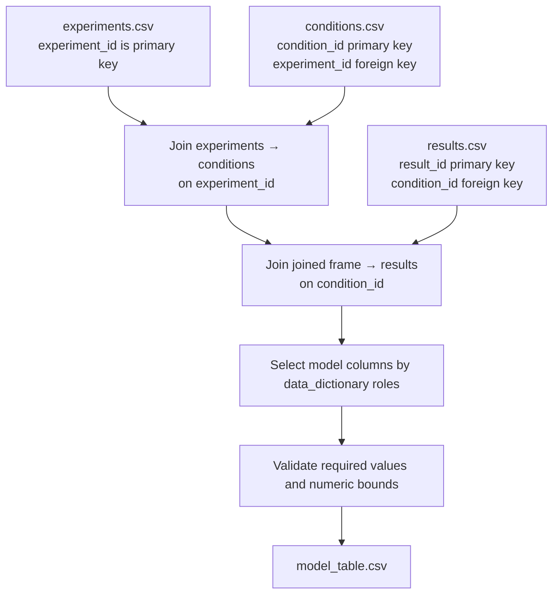

# Fixed Mirai multi-table contract → `model_table.csv`

This tutorial defines the Mirai intake contract that every tabular engineering project should follow.

The key decision is:

> Mirai accepts a fixed set of relational source CSVs and deterministically materializes the training file `model_table.csv` from them.

This is the product contract we should explain, test, and preserve in code.

## The fixed project structure

Every standard Mirai tabular DoE package should be a folder or ZIP with these root files:

```text
mirai_package/
  mirai_manifest.json      # project metadata, fixed table declarations, joins, split/UI hints
  data_dictionary.csv      # column roles, dtypes, units, ranges, directions, labels
  experiments.csv          # one row per physical sample/test article/experiment
  conditions.csv           # one row per modelable condition/operating point
  results.csv              # one row per averaged/scalar measured result
```

Mirai then generates:

```text
canonical/model_table.csv  # one row per modelable observation used for training
```

Transitional compatibility: old packages that already include root-level `model_table.csv` still work. But the preferred contract is source-table-first: `experiments.csv` + `conditions.csv` + `results.csv`.

## Accepted tables only

The fixed runtime contract accepts these source tables:

| Table | Required? | Grain | Required keys | Purpose |
|---|---:|---|---|---|
| `experiments.csv` | Yes | One row per sample/test article/experiment | `experiment_id` | Stable sample/formulation/campaign metadata. |
| `conditions.csv` | Yes | One row per modelable condition/operating point | `condition_id`, `experiment_id` | Inputs that vary by operating/process/test condition. |
| `results.csv` | Yes | One row per averaged/scalar result for a condition | `condition_id` plus a unique result identifier | Output KPIs measured under a condition. |
| `data_dictionary.csv` | Yes | One row per model-relevant variable | `path`, `source_name`, `variable_id`, `ui_label`, `role`, `dtype`, `required` | Declares how each client-native source column maps into Mirai. |
| `mirai_manifest.json` | Yes | One project/package declaration | n/a | Declares project metadata, table joins, split hints, plot recipes. |

Do not invent one-off runtime tables for each client. Client-native files should be transformed into these generic table names before upload.

## Generic naming rules

Use generic, stable column names in the Mirai package even if the client has different native names.

Required keys:

```text
experiments.csv: experiment_id
conditions.csv:  condition_id, experiment_id
results.csv:     result_id, condition_id
```

Recommended generic grouping/provenance columns:

```text
campaign_id
group_id
sample_id
source_file
source_row
notes
```

Domain-specific variables are allowed as input/output columns, and each client can have a different number of them. Their roles must be declared in `data_dictionary.csv` and `mirai_manifest.json` using three naming layers:

1. `source_name`: exact client/source CSV column, for example `Pt/C ratio (%)`.
2. `variable_id`: immutable Mirai/model id. For new fixed source-table packages, model inputs use contiguous `x1..xN` and outputs use contiguous `y1..yM`, for example `x1` for the first input.
3. `ui_label`: user-facing display label, for example `Pt/C ratio`.

The model trains on `variable_id` columns only. The app can show curated `ui_label` values, and review/detail panels can show source provenance. Domain names such as `Pt/C ratio` or `Operating voltage` belong in `source_name`, `ui_label`, descriptions, and units — not in input/output `variable_id`s for new fixed packages.

For the Fraunhofer PEM fuel-cell dataset, the model variables are generic internal columns with semantic metadata:

```text
Inputs X
- x1  (ui_label: Pt/C ratio)
- x2  (ui_label: I/C ratio)
- x3  (ui_label: Ionomer EW)
- x4  (ui_label: Operating RH)
- x5  (ui_label: Operating voltage)
- x6  (ui_label: AST RH)
- x7  (ui_label: AST UPL)

Outputs Y
- y1  (ui_label: BoL current density)
- y2  (ui_label: EoL current density)
- y3  (ui_label: BoL ECSA)
- y4  (ui_label: ECSA loss)
```

## High-level diagram



## What `model_table.csv` means

`model_table.csv` is the file that training consumes. It is the canonical ML fitting table.

Each row should answer:

> Given these experiment/sample/design/operating conditions, what measured response did we observe?

For Fraunhofer, one row can be interpreted as:

```text
experiment_id + operating point + AST/degradation setup → measured fuel-cell response KPIs
```

For Fraunhofer, `experiment_id` is the generic Mirai key and `Cell_01`, `Cell_02`, etc. are its values.

Example generated model table columns:

```csv
experiment_id,pt_c_ratio,i_c_ratio,ionomer_ew,operating_rh,operating_voltage,ast_rh,ast_upl,bol_current_density,eol_current_density,bol_ecsa,ecsa_loss
Cell_01,0.5,0.5,790,100,0.60,100,0.95,1.42,1.18,139.6,0.325
```

Important: `model_table.csv` does **not** mean all original information has to be physically born in one CSV. It means Mirai has produced or received one final row-wise surface for modeling.

## Source table details

### `experiments.csv`

One row per tested physical sample, cell, specimen, formulation, or campaign item.

Fraunhofer interpretation:

```text
one row per Cell_NN / test number from data_overview.xlsx
```

Example:

```csv
experiment_id,test_no,campaign_id,pt_c_ratio,i_c_ratio,ionomer_ew,ast_rh,ast_upl,catalyst_type,support_type
Cell_01,1,Fraunhofer_Cathode_Degradation,0.5,0.5,790,100,0.95,PtCo/C,carbon_support_A
Cell_02,2,Fraunhofer_Cathode_Degradation,0.4,0.6,790,100,0.95,PtCo/C,carbon_support_A
```

### `conditions.csv`

One row per modelable condition under which an experiment/sample was evaluated.

Fraunhofer interpretation:

```text
one row per experiment_id × operating condition, especially operating voltage and RH
```

Example:

```csv
condition_id,experiment_id,operating_rh,operating_voltage,curve_variant
Cell_01_V060_RH100,Cell_01,100,0.60,polarization
Cell_01_V065_RH100,Cell_01,100,0.65,polarization
```

### `results.csv`

One row per measured or derived target result for the same modelable condition.

Fraunhofer interpretation:

```text
averaged/scalar KPIs from the relevant IV/CV/ECSA evaluation outputs
```

Example:

```csv
result_id,condition_id,bol_current_density,eol_current_density,bol_ecsa,ecsa_loss
R001,Cell_01_V060_RH100,1.42,1.18,139.6,0.325
R002,Cell_01_V065_RH100,1.31,1.05,139.6,0.325
```

## Deterministic mapping into `model_table.csv`

The conceptual transform is:



Equivalent pandas-style logic:

```python
experiments = read_csv("experiments.csv")
conditions = read_csv("conditions.csv")
results = read_csv("results.csv")

joined = experiments.merge(
    conditions,
    on="experiment_id",
    how="inner",
    validate="one_to_many",
)

joined = joined.merge(
    results,
    on=["condition_id"],
    how="inner",
    validate="one_to_one",
)

model_table = joined[
    [
        # IDs / grouping / provenance
        "experiment_id",
        "condition_id",
        "campaign_id",

        # inputs
        "pt_c_ratio",
        "i_c_ratio",
        "ionomer_ew",
        "operating_rh",
        "operating_voltage",
        "ast_rh",
        "ast_upl",

        # outputs
        "bol_current_density",
        "eol_current_density",
        "bol_ecsa",
        "ecsa_loss",
    ]
]
```

## How this maps to Fraunhofer source files

Source root:

```text
./data/Cathode Catalyst Degradation/
  02-Testing_overview/data_overview.xlsx
  01-Data/Cell_01.zip ... Cell_42.zip
  03-Evaluation_scripts/raw_data_files/*.csv
  mirai_manifest_template.json
  data_dictionary_template.csv
```

Recommended staging transform:

| Fraunhofer source | Mirai staging table | Notes |
|---|---|---|
| `02-Testing_overview/data_overview.xlsx` | `experiments.csv` | Extract one row per `Cell_NN` / `Test no.`. Keep formulation, catalyst, AST, and campaign metadata here. |
| `01-Data/Cell_NN.zip` | `raw_reference/` inventory, or offline-derived result tables | Do not ask runtime training to expand all raw ZIP contents. Use them for audit/provenance or offline KPI extraction. |
| IV / polarization outputs | `conditions.csv` + `results.csv` | Operating voltage/RH becomes condition data; current-density KPIs become result columns. |
| CV/ECSA outputs | `results.csv` | ECSA scalar summaries join by `cell_id` and degradation/cycle convention. |
| EIS/LSV/limiting-current files | optional `metadata/*.csv` or future outputs | Include only if they become model inputs/outputs or approved metadata. |
| Existing `data/reference/pem_fuel_cell_cathode_degradation/model_table.csv` | `model_table.csv` | Current known-good canonical training surface. |

## What the current code does today

Current runtime path:

```text
backend/ml_lifecycle/ingesting/generic_tabular_doe/contract.py
backend/ml_lifecycle/ingesting/generic_tabular_doe/preprocessing.py
```

### 1. Package discovery

`build_generic_preprocessing_artifacts(...)` calls `_prepare_package_root(...)`.

It accepts either:

1. fixed source-table files at package root:

```text
mirai_manifest.json
data_dictionary.csv
experiments.csv
conditions.csv
results.csv
```

2. transitional compatibility files at package root:

```text
mirai_manifest.json
data_dictionary.csv
model_table.csv
```

or:

3. one ZIP package containing either shape at ZIP root or under one top-level folder.

### 2. Contract validation

`load_and_validate_contract(...)` requires:

- `mirai_manifest.json` exists;
- `data_dictionary.csv` exists;
- manifest `project.template_id` is `generic_tabular_doe`;
- manifest declares at least one table;
- package either includes `model_table.csv` or the fixed source tables `experiments.csv`, `conditions.csv`, and `results.csv`;
- fixed source packages declare the required keys for `experiments.csv` and `conditions.csv`;
- manifest declares columns with roles/dtypes/units;
- at least one `input` and one `output` column exist;
- output columns declare optimization direction: `maximize`, `minimize`, or `target`;
- joins, if present, reference declared tables and keys.

### 3. Table construction

`_build_joined_table(...)` reads declared CSV/XLSX tables.

Behavior:

- If `model_table.csv` is declared and present, the code uses it directly for transitional compatibility.
- If the fixed source tables are declared and present, the code applies manifest joins. If joins are omitted, validation supplies the default fixed joins: `experiments.csv → conditions.csv` on `experiment_id`, then `conditions.csv → results.csv` on `condition_id`.
- For joined packages, the code starts from the `left_table` of the first join and applies joins in order.
- Join order must be linear: every later join's `left_table` must already be in the joined frame.
- Join relationship controls pandas validation:
  - `one_to_one` → `validate="one_to_one"`
  - `one_to_many` or `many_to_one` currently map to `validate="one_to_many"` in implementation.
- The resulting joined frame is then reduced to the manifest/data-dictionary columns whose role is not `ignore`.

### 4. Row validation and canonical artifact writing

The preprocessing step:

- coerces declared dtypes;
- checks required values;
- checks `allowed_min` / `allowed_max` for input and output columns;
- rejects invalid rows into `rejected_rows.csv`;
- assigns a split using `split_hints`;
- writes the accepted canonical table to:

```text
canonical_dir/model_table.csv
```

It also writes artifacts such as:

```text
schema.json
preprocessing.json
split_report.json
validation_report.json
dataset_profile.json
eda_report.json
package_inventory.json
raw_reference_inventory.json
```

## Current runtime behavior

The runtime now supports the fixed source-table contract directly:

```text
Clients provide experiments.csv + conditions.csv + results.csv + manifest joins.
Mirai deterministically materializes model_table.csv during preprocessing.
```

For backward compatibility, a package that already includes `model_table.csv` still works. However, the fixed project contract should be source-table-first.

## Recommended Fraunhofer package v1

For the current pilot, use this source-table-first package shape:

```text
fraunhofer_cathode_degradation_mirai_package/
  mirai_manifest.json
  data_dictionary.csv
  experiments.csv
  conditions.csv
  results.csv
  metadata/
    source_file_inventory.csv
  raw_reference/
    README.md
```

Where:

- `experiments.csv`, `conditions.csv`, and `results.csv` are the uploaded source tables.
- Mirai generates `model_table.csv` during preprocessing.
- `data_dictionary.csv` declares the semantic role of every model-relevant source column.
- `mirai_manifest.json` declares tables, keys, joins, split hints, and UI hints.
- `raw_reference/` does not need to contain huge ZIPs in Git or runtime; it can point to object-storage keys or source inventory hashes.

## Recommended Fraunhofer manifest pattern

Declare the fixed source tables and joins. Do not require clients to ship `model_table.csv` if the source tables contain everything needed to materialize it.

```json
{
  "manifest_version": "0.3",
  "project": {
    "project_id": "pem_fuel_cell_real_cathode_degradation",
    "display_name": "Fraunhofer Cathode Catalyst Degradation",
    "domain": "fuel_cell",
    "template_id": "generic_tabular_doe",
    "owner": "Fraunhofer"
  },
  "tables": [
    {
      "path": "experiments.csv",
      "table_type": "experiments",
      "primary_key": ["experiment_id"],
      "description": "One row per tested Cell_NN sample."
    },
    {
      "path": "conditions.csv",
      "table_type": "conditions",
      "primary_key": ["condition_id", "experiment_id"],
      "description": "One row per modelable operating condition."
    },
    {
      "path": "results.csv",
      "table_type": "results",
      "primary_key": ["result_id"],
      "description": "One row per averaged/scalar KPI result."
    }
  ],
  "joins": [
    {"left_table": "experiments.csv", "right_table": "conditions.csv", "keys": ["experiment_id"], "relationship": "one_to_many"},
    {"left_table": "conditions.csv", "right_table": "results.csv", "keys": ["condition_id"], "relationship": "one_to_one"}
  ],
  "split_hints": {
    "predefined_split_column": "split",
    "recommended_strategy": "predefined_column"
  }
}
```

Column declarations may live in `mirai_manifest.json`, `data_dictionary.csv`, or both. For new fixed source-table packages, every model-relevant column should declare `source_name`, `variable_id`, `ui_label`, and role. Input/output `variable_id`s must be contiguous generic IDs (`x1..xN` and `y1..yM`). The important point is that each variable has a declared role: `id`, `group`, `metadata`, `input`, or `output`.

## Suggested improvement for multi-client robustness

Clients will differ in notation. Do not force every client to use Fraunhofer column names in their source files or model columns. Instead, use a two-layer contract:

### Layer 1: source/staging schema

Accept client-native CSV names, but document them clearly:

```text
client file: TestOverview.csv
client column: PtC
ui label / semantic meaning: Pt/C ratio
unit: ratio
role: input
internal model id: x1
```

### Layer 2: canonical model schema

Transform source columns into Mirai's canonical `model_table.csv` columns for that project:

```text
Pt/C ratio (%)   → x1 → Pt/C ratio
Ionomer EW       → x3 → Ionomer EW
Voltage / U_cell → x5 → Operating voltage
j_BOL            → y1 → BoL current density
```

This is represented in `data_dictionary.csv` with mapping fields, for example:

```csv
path,source_name,variable_id,ui_label,role,dtype,unit,required,direction
experiments.csv,Pt/C ratio (%),x1,Pt/C ratio,input,float,%,true,
conditions.csv,U_cell,x5,Operating voltage,input,float,V,true,
results.csv,j_BOL,y1,BoL current density,output,float,A/cm2,true,maximize
```

Mirai materializes `model_table.csv` using `variable_id` columns. The source names remain provenance, and `ui_label` can be curated in the app.

## Design rules for client data

1. **Every model row must have stable keys.**
   Example: `cell_id`, `condition_id`, or `experiment_id`.

2. **Inputs and outputs must be separated semantically.**
   Inputs are knobs/conditions/material descriptors. Outputs are measured KPIs.

3. **High-frequency raw traces should not be training rows by default.**
   They should be averaged or reduced into scalar KPIs before entering `results.csv`, unless the model is explicitly a time-series model.

4. **Aggregation must be explicit.**
   If multiple rows become one output value, document whether it is `mean`, `median`, `last`, `max`, `area_under_curve`, interpolation, etc.

5. **The final model table must be reproducible.**
   Given the source tables and manifest rules, another engineer should be able to regenerate the same `model_table.csv`.

6. **Raw files are audit/provenance unless promoted.**
   Large ZIPs and instrument dumps belong in object storage or `raw_reference`, not as hidden runtime dependencies for training.

## Practical answer for client conversations

Use this explanation:

> Mirai trains on one canonical file called `model_table.csv`. That does not mean your lab must store data in one file. You can provide relational CSVs such as `experiments.csv`, `conditions.csv`, and `results.csv`. We map those tables using declared keys into a reproducible training table. The final table has one row per modelable observation, with input columns for design/conditions and output columns for measured KPIs.

For Fraunhofer:

```text
data_overview.xlsx       → experiments.csv
Cell_NN measurement KPIs → conditions.csv + results.csv
joined/reduced output    → model_table.csv
```

## Recommended next actions

1. Update `frontend/public/templates/mirai_manifest_multitable_template.json` so it includes `model_table.csv` and explains whether source tables are staging/provenance or materialized-by-Mirai inputs.
2. Add an explicit `transform` section to the manifest if Mirai should build `model_table.csv` from multi-table inputs without requiring the file to be pre-created.
3. Create a small Fraunhofer package fixture with:
   - `experiments.csv`
   - `conditions.csv`
   - `results.csv`
   - generated `model_table.csv`
   - manifest joins
   - data dictionary roles
4. Add a regression test proving that the declared joins produce exactly the expected `model_table.csv` rows.
5. Later, add a mapping layer for client-native column names so each new client only needs a dictionary/mapping file, not custom code.
